  

 

 

<picture>
  <source media="(prefers-color-scheme: dark)" srcset="./assets/about-dark.svg">
  <source media="(prefers-color-scheme: light)" srcset="./assets/about-light.svg">
  
</picture>

 

I work across machine learning, backend engineering, and full-stack development. I enjoy taking ideas beyond notebooks and prototypes, building applications that people can actually use.

 

## Projects

| Project | Problem Statement | Solution | Links |
|:--|:--|:--|:--|
| **EV Charging Site Suitability Analysis** *(EY engagement)* | Deciding where to put new EV charging stations is usually done on gut feel or a single metric. A site can look busy on a map but sit far from a transformer with spare capacity, have weak network coverage for payments and monitoring, or never pay back its cost. Planners needed one defensible, ranked shortlist that balances demand, grid readiness, connectivity and finances. | Merged **4 operational datasets** (**12,000 records**: station sales, toll traffic, telecom towers, transformers) with an **India state-boundary map** through **8 cross-dataset relations** (state-level joins plus nearest-neighbour geospatial lookups). Profiled **107 active stations** and **2,728 charging sessions** across **10 states**, then scored **1,915 candidate locations** (from a 2,500-point national grid) and filtered to **710 financially viable sites**. A **6-criterion AHP** model combined with **XGBoost** predictions produced a final shortlist of **10 sites**, kept at least **30 km apart**, with total CAPEX of **₹2.5 Cr** against a **₹5 Cr** budget. Results are served through a **Flask API (3 endpoints)** and **3 interactive Folium maps**. `Python` · `Pandas` · `XGBoost` · `GeoPandas` · `Folium` · `Flask` |  *Code and live demo are not public. Walkthrough available on request.* |
| **NEURO CAMPUS** | Colleges run academics across disconnected tools: attendance, notes, assessments and student support live in different places, so students and faculty lose time and insight. | A multi-role campus platform where students, faculty and admins work in one place, with AI features layered on top. Team project; I own the AI/ML side. `React` · `FastAPI` · `Gemini API` · `Supabase` | [Live](https://neuro-campus-73w8.vercel.app/) · [Code](https://github.com/jiyanshuj?tab=repositories&q=neuro) |
| **AutoSlideX** | Building a presentation from scratch eats hours before the real thinking even starts: outlining, structuring and laying out slides. | Enter a topic and get a complete slide deck generated with generative AI, ready to refine. `React` · `FastAPI` · `Gemini API` | [Live](https://auto-slide-x.vercel.app/) · [Code](https://github.com/jiyanshuj?tab=repositories&q=slide) |
| **Smart Career Guidance** | Students pick tech careers from hype or peer pressure and rarely know which path actually fits their skills. | An adaptive assessment that adjusts its questions to the student and recommends suitable tech career paths. `React` · `Flask` · `Gemini API` · `Supabase` | [Live](https://smart-career-guidance-system.vercel.app/) · [Code](https://github.com/jiyanshuj?tab=repositories&q=career) |
| **HealthGuard AI** | Early warning signs of health risk are easy to miss, and most people have no simple way to check where they stand. | Takes a few health inputs from the user and predicts their risk level through a simple web interface. `Python` · `scikit-learn` · `Streamlit` | [Live](https://health-guard-ai.streamlit.app/) · [Code](https://github.com/jiyanshuj?tab=repositories&q=health) |

More on my [GitHub repositories](https://github.com/jiyanshuj?tab=repositories), including a KNN face-recognition attendance system (Flask + React) and EV-station data scrapers.

 

## Toolkit

<picture>
  <source media="(prefers-color-scheme: dark)" srcset="./assets/toolkit-dark.svg">
  <source media="(prefers-color-scheme: light)" srcset="./assets/toolkit-light.svg">
  
</picture>

<b>How the stack fits together (click to expand)</b>

 

| Lane | What I reach for it to do |
|:--|:--|
| **Languages** | Python for ML and APIs, TypeScript and JavaScript for the web, C++ and Java for fundamentals, SQL for data |
| **Data and Geo** | Pandas and NumPy for shaping data, PostgreSQL with PostGIS and GeoPandas for geospatial work, MongoDB, Redis, Supabase and Firebase for app data |
| **Models** | scikit-learn, XGBoost, TensorFlow, PyTorch and OpenCV for modeling, SHAP for explanations, Gemini API for generative features |
| **Apps** | FastAPI, Flask and Django for backends, React and React Native with Tailwind and Vite for interfaces |
| **Ship** | Azure and Databricks for cloud and pipelines, Vercel and Render for hosting, Git, GitHub, Postman, Jupyter and VS Code for daily workflow |

 

## Certifications

 

<!-- Footer: assets/footer.webp sliced into clickable pieces. Keep each row on one line and widths proportional (99.5% total) so no seams appear. -->

