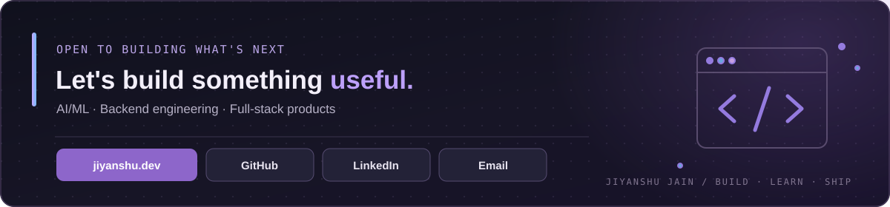

<<<<<<< HEAD

  

  <a href="https://jiyanshu.dev">Portfolio</a> &nbsp;·&nbsp;
  <a href="https://linkedin.com/in/jiyanshu-jain">LinkedIn</a> &nbsp;·&nbsp;
  <a href="mailto:jainjiyanshu@gmail.com">Email</a>

 
=======
# Hey 👋, I'm Jiyanshu Jain

### 💡 Data Science Intern @ EY · Full-Stack Developer · AI/ML Builder

Currently building an EV charging site selection pipeline at EY — XGBoost + AHP scoring across 3,000+ stations in 9 Indian states using GeoPandas, Azure Databricks, and PostGIS.

> *"Geospatial ML at EY by day. AI products on GitHub by night."*

---
>>>>>>> 594e54de17fb8175fa115ad63cd32fe1612d2e71

## 01 &nbsp;About

<<<<<<< HEAD
I work across machine learning, backend engineering, and full-stack development. I enjoy taking ideas beyond notebooks and prototypes, building applications that people can actually use.

I'm a final-year B.Tech student in Computer Science (AI & ML) at SVVV, Indore. Right now I'm an AI/ML engineering intern at **EY**, working on data science and geospatial modelling. Outside of work I build full-stack products with React, FastAPI and Flask, and I like digging into algorithms, system design, and what it takes to make software hold up as it grows.

 

## 02 &nbsp;What I Build

<table>
  <tr>
    <td width="33%" valign="top">
      <h4>AI/ML &amp; Data Science</h4>
      <ul>
        <li>Machine learning models and predictive analytics</li>
        <li>Computer vision and face recognition</li>
        <li>Generative AI integration</li>
        <li>Data processing and geospatial analysis</li>
      </ul>
    </td>
    <td width="33%" valign="top">
      <h4>Full-Stack Engineering</h4>
      <ul>
        <li>React and TypeScript applications</li>
        <li>FastAPI, Flask and REST APIs</li>
        <li>Authentication and database integration</li>
        <li>Responsive web and mobile apps</li>
      </ul>
    </td>
    <td width="33%" valign="top">
      <h4>Cloud &amp; Data Systems</h4>
      <ul>
        <li>Azure and Azure Databricks</li>
        <li>PostgreSQL, PostGIS and MongoDB</li>
        <li>Redis caching</li>
        <li>Deployment on Vercel and Render</li>
      </ul>
    </td>
  </tr>
=======
**🤖 AI/ML & Data Science**
- Built XGBoost + AHP hybrid scoring pipeline for EV infrastructure planning across India at **EY**
- Developed ML resume-job matching engine with **92% extraction accuracy** at Hired Easy
- Created face recognition attendance system using **KNN** and smart career guidance with **Gemini API**

**🌐 Full-Stack Development**
- Architected **RESTful APIs** with FastAPI and Flask for production AI workflows
- Built full-stack platforms with React, TypeScript, Supabase, and PostgreSQL
- Developed React Native mobile app with swipe-based job matching and AI resume parsing

**☁️ Cloud & Data Engineering**
- Built geospatial pipelines with **GeoPandas, PostGIS, Azure Databricks**
- Worked with **QGIS, Folium, OSMnx, Overpass API** for spatial data extraction
- Redis caching, Cloudinary file storage, MongoDB for scalable data management

---

## 🚀 Featured Projects

| Project | Stack | Live |
|---|---|---|
| **EV Site Selection @ EY** | XGBoost · AHP · GeoPandas · Azure Databricks · PostGIS | Internal |
| **[NEURO CAMPUS](https://neuro-campus-73w8.vercel.app/)** | React · FastAPI · Gemini API · KNN · Supabase | ✅ Live |
| **[AutoSlideX](https://auto-slide-x.vercel.app/)** | React · FastAPI · Gemini API · python-pptx | ✅ Live |
| **[Resume Parser API](https://resume-parse-1.onrender.com)** | FastAPI · Gemini AI · MongoDB · Cloudinary | ✅ Live |
| **[HealthGuard AI](https://health-guard-ai.streamlit.app/)** | Python · Streamlit · scikit-learn | ✅ Live |
| **[Smart Career Guidance](https://smart-career-guidance-system.vercel.app/)** | React · Flask · Gemini API · Supabase | ✅ Live |

---

## 💻 Tech Stack

<table>
<tr>
<td width="50%">

### 🎯 Languages
| | | | |
|:---:|:---:|:---:|:---:|
|  |  |  |  |
|  |  |  | |

</td>
<td width="50%">

### 🚀 Frameworks & Libraries
| | | | |
|:---:|:---:|:---:|:---:|
|  |  |  |  |
|  |  |  | |

</td>
</tr>

<tr>
<td width="50%">

### 🤖 AI/ML & Data Science
| | | | |
|:---:|:---:|:---:|:---:|
|  |  |  |  |
|  |  |  | |

</td>
<td width="50%">

### 🗄️ Databases
| | | | |
|:---:|:---:|:---:|:---:|
|  |  |  |  |
|  |  | | |

</td>
</tr>

<tr>
<td width="50%">

### ☁️ Cloud & Data Engineering
| | | | |
|:---:|:---:|:---:|:---:|
|  |  |  | |
|  |  |  | |

</td>
<td width="50%">

### 🛠️ Tools
| | | | |
|:---:|:---:|:---:|:---:|
|  |  |  |  |
|  |  |  | |

</td>
</tr>
>>>>>>> 594e54de17fb8175fa115ad63cd32fe1612d2e71
</table>

 

<<<<<<< HEAD
## 03 &nbsp;Engineering Toolkit

  

=======
## 🏅 Certifications

- 🟠 Oracle OCI 2025 Certified Data Science Professional
- 🔵 Microsoft Azure AI Fundamentals (AI-900)
- 🔵 Microsoft Azure Fundamentals
- 🔵 IBM Data Analysis Using Python
- 🔴 NPTEL Joy of Computing using Python — Elite (80%)

---

## 🌐 Connect with Me

- [LinkedIn](https://linkedin.com/in/jiyanshu-jain)
- [GitHub](https://github.com/jiyanshuj)
- [Instagram](https://instagram.com/jiyanshu.j)
- 📫 Email: [jiyanshujain321@gmail.com](mailto:jiyanshujain321@gmail.com)
- 👨‍💻 Portfolio: [https://jiyanshu.dev](https://jiyanshu.dev)
- 📄 Resume: [View My Resume](https://drive.google.com/file/d/1OUIlZIIZFvnhvsNnl2FxfpIFOzOWQ_u1/view?usp=sharing)
>>>>>>> 594e54de17fb8175fa115ad63cd32fe1612d2e71

 

## 04 &nbsp;Featured Projects

<table>
  <tr>
    <td width="50%" valign="top">
      <h3>NEURO CAMPUS</h3>
      
A team-built educational platform that brings academic workflows, AI features and database-backed apps into one place. I work on the AI/ML side.

      
<b>React · FastAPI · Gemini API · Supabase</b>

      
<a href="https://neuro-campus-73w8.vercel.app/">Live demo</a> &nbsp;·&nbsp; <a href="https://github.com/jiyanshuj?tab=repositories&q=neuro">Source</a>

    </td>
    <td width="50%" valign="top">
      <h3>AutoSlideX</h3>
      
Turns a topic into a slide deck. Generative AI drafts the content and the app assembles the slides automatically.

      
<b>React · FastAPI · Gemini API · Python</b>

      
<a href="https://auto-slide-x.vercel.app/">Live demo</a> &nbsp;·&nbsp; <a href="https://github.com/jiyanshuj?tab=repositories&q=slide">Source</a>

    </td>
  </tr>
  <tr>
    <td width="50%" valign="top">
      <h3>Smart Career Guidance</h3>
      
Helps students find a technology career path through an adaptive assessment, then recommends directions based on the results.

      
<b>React · Flask · Gemini API · Supabase</b>

      
<a href="https://smart-career-guidance-system.vercel.app/">Live demo</a> &nbsp;·&nbsp; <a href="https://github.com/jiyanshuj?tab=repositories&q=career">Source</a>

    </td>
    <td width="50%" valign="top">
      <h3>Resume Parser API</h3>
      
A service that extracts structured information from resumes, so unstructured documents become data an application can use.

      
<b>FastAPI · Gemini API · MongoDB · Cloudinary</b>

      
<a href="https://resume-parse-1.onrender.com">Live API</a> &nbsp;·&nbsp; <a href="https://github.com/jiyanshuj?tab=repositories&q=resume">Source</a>

    </td>
  </tr>
  <tr>
    <td width="50%" valign="top">
      <h3>HealthGuard AI</h3>
      
A machine learning app that predicts health risk from user inputs, wrapped in a simple Streamlit interface.

      
<b>Python · scikit-learn · Streamlit</b>

      
<a href="https://health-guard-ai.streamlit.app/">Live demo</a> &nbsp;·&nbsp; <a href="https://github.com/jiyanshuj?tab=repositories&q=health">Source</a>

    </td>
    <td width="50%" valign="top">
      <h3>More on GitHub</h3>
      
Including a KNN face-recognition attendance system with a Flask API and React frontend, and scrapers for vehicle-registration and EV-station data.

      
<b>Flask · React · OpenCV · Playwright</b>

      
<a href="https://github.com/jiyanshuj?tab=repositories">All repositories</a>

    </td>
  </tr>
</table>

 

## 05 &nbsp;Experience

<table>
  <tr>
    <td width="50%" valign="top">
      <h4>EY &nbsp;·&nbsp; AI/ML Engineer (Intern)</h4>
      <ul>
        <li>Geospatial ML pipeline for EV charging site selection</li>
        <li>XGBoost models combined with AHP scoring, explained with SHAP</li>
        <li>GeoPandas and PostGIS for spatial analysis</li>
        <li>Data workflows on Azure Databricks</li>
      </ul>
    </td>
    <td width="50%" valign="top">
      <h4>Hired Easy &nbsp;·&nbsp; Software Developer (Intern)</h4>
      <ul>
        <li>Resume-parsing ML backend for AI-powered resume and job matching</li>
        <li>Redis-cached job APIs and backend API integration</li>
        <li>React Native application development</li>
      </ul>
    </td>
  </tr>
</table>

 

## 06 &nbsp;GitHub Analytics

  
  

  

  

Live stats from third-party services. If a card doesn't load, see my <a href="https://github.com/jiyanshuj">profile</a> directly.

 

## 07 &nbsp;Certifications

- Oracle OCI Data Science Professional
- Microsoft Azure AI Fundamentals (AI-900)
- Microsoft Azure Fundamentals
- IBM — Data Analysis Using Python
- NPTEL — The Joy of Computing Using Python

 

## 08 &nbsp;Connect

  

  <a href="https://jiyanshu.dev">Portfolio</a> &nbsp;·&nbsp;
  <a href="https://github.com/jiyanshuj">GitHub</a> &nbsp;·&nbsp;
  <a href="https://linkedin.com/in/jiyanshu-jain">LinkedIn</a> &nbsp;·&nbsp;
  <a href="mailto:jainjiyanshu@gmail.com">jainjiyanshu@gmail.com</a>

