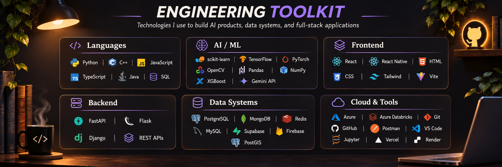

  

  Final-year B.Tech (CS, AI &amp; ML) &nbsp;·&nbsp; AI/ML Engineering Intern at <b>EY</b> &nbsp;·&nbsp; Open to AI/ML, backend and full-stack roles

I work across machine learning, backend engineering, and full-stack development. I enjoy taking ideas beyond notebooks and prototypes, building applications that people can actually use.

 

## Featured Projects

<table>
  <tr>
    <td width="50%" valign="top">
      <h3>NEURO CAMPUS</h3>
      
Team-built educational platform combining academic workflows, AI features and database-backed apps. I own the AI/ML side.

      
<b>React · FastAPI · Gemini API · Supabase</b>

      
<a href="https://neuro-campus-73w8.vercel.app/">Live demo</a> &nbsp;·&nbsp; <a href="https://github.com/jiyanshuj?tab=repositories&q=neuro">Source</a>

    </td>
    <td width="50%" valign="top">
      <h3>AutoSlideX</h3>
      
Generates a slide deck from a topic: generative AI drafts the content and the app assembles the slides.

      
<b>React · FastAPI · Gemini API · Python</b>

      
<a href="https://auto-slide-x.vercel.app/">Live demo</a> &nbsp;·&nbsp; <a href="https://github.com/jiyanshuj?tab=repositories&q=slide">Source</a>

    </td>
  </tr>
  <tr>
    <td width="50%" valign="top">
      <h3>Smart Career Guidance</h3>
      
Adaptive assessment that recommends technology career paths based on a student's results.

      
<b>React · Flask · Gemini API · Supabase</b>

      
<a href="https://smart-career-guidance-system.vercel.app/">Live demo</a> &nbsp;·&nbsp; <a href="https://github.com/jiyanshuj?tab=repositories&q=career">Source</a>

    </td>
    <td width="50%" valign="top">
      <h3>Resume Parser API</h3>
      
Extracts structured data from resumes so documents become usable records for an application.

      
<b>FastAPI · Gemini API · MongoDB · Cloudinary</b>

      
<a href="https://resume-parse-1.onrender.com">Live API</a> &nbsp;·&nbsp; <a href="https://github.com/jiyanshuj?tab=repositories&q=resume">Source</a>

    </td>
  </tr>
  <tr>
    <td width="50%" valign="top">
      <h3>HealthGuard AI</h3>
      
Machine learning app that predicts health risk from user inputs, served through Streamlit.

      
<b>Python · scikit-learn · Streamlit</b>

      
<a href="https://health-guard-ai.streamlit.app/">Live demo</a> &nbsp;·&nbsp; <a href="https://github.com/jiyanshuj?tab=repositories&q=health">Source</a>

    </td>
    <td width="50%" valign="top">
      <h3>More work</h3>
      
KNN face-recognition attendance system (Flask API + React), plus scrapers for vehicle-registration and EV-station data.

      
<b>Flask · React · OpenCV · Playwright</b>

      
<a href="https://github.com/jiyanshuj?tab=repositories">All repositories</a>

    </td>
  </tr>
</table>

 

## Experience

<table>
  <tr>
    <td width="50%" valign="top">
      <h4>EY &nbsp;·&nbsp; AI/ML Engineer (Intern)</h4>
      <ul>
        <li>Geospatial ML pipeline for EV charging site selection</li>
        <li>XGBoost + AHP scoring, explained with SHAP</li>
        <li>GeoPandas, PostGIS and Azure Databricks</li>
      </ul>
    </td>
    <td width="50%" valign="top">
      <h4>Hired Easy &nbsp;·&nbsp; Software Developer (Intern)</h4>
      <ul>
        <li>Resume-parsing ML backend for resume and job matching</li>
        <li>Redis-cached job APIs and backend integration</li>
        <li>React Native app development</li>
      </ul>
    </td>
  </tr>
</table>

 

## Toolkit

  

 

## Certifications

Oracle OCI Data Science Professional &nbsp;·&nbsp; Microsoft Azure AI Fundamentals (AI-900) &nbsp;·&nbsp; Microsoft Azure Fundamentals &nbsp;·&nbsp; IBM Data Analysis Using Python &nbsp;·&nbsp; NPTEL The Joy of Computing Using Python

 

<!-- Footer: assets/footer.webp sliced into clickable pieces. Keep each row on one line and widths proportional (99.5% total) so no seams appear. -->

